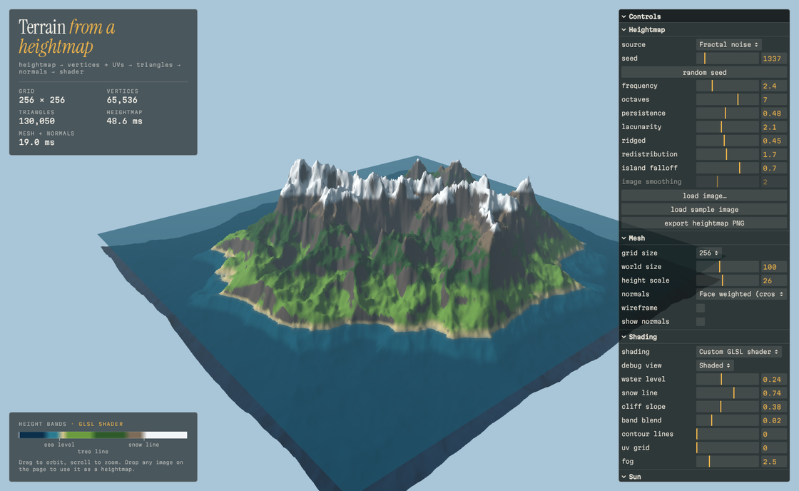
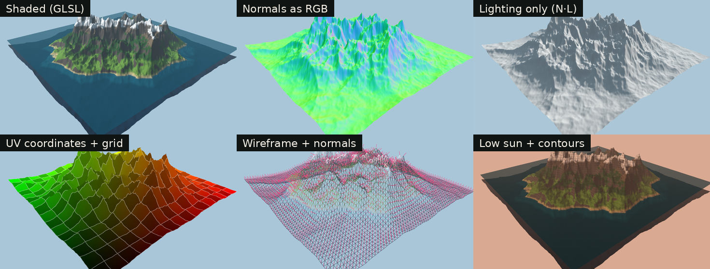

# Procedural Terrain

A heightmap goes in, a lit and colored 3D terrain comes out. The heightmap is either generated from seeded fractal noise or read from any image you drop on the page. Every array the GPU draws (vertices, UVs, triangle indices, normals) is built by hand in `src/mesh.js`, and the terrain's coloring and lighting are done in a custom GLSL shader. three.js provides the renderer, the camera and orbit controls, and the built-in materials used for the water and for the optional Lambert comparison mode.



## Run it

Requires Node 22.12+ (Vite 8 and Vitest 5).

```bash
npm install
npm run dev      # http://localhost:5173
npm test         # unit tests for the noise, mesh and normals math
npm run build    # static site in dist/
```

Pushing to `main` also deploys the demo to GitHub Pages through `.github/workflows/deploy.yml` (one time setup: Settings > Pages > Source: GitHub Actions).

Every control can also be set from the URL, which makes views easy to share. For example `?view=1` opens the normals view and `?source=image` loads the sample image. Values from the URL are clamped to the slider ranges and checked against the dropdown options.

## The pipeline

```
seed or image ──> heightmap ──> vertices + UVs ──> triangles ──> normals ──> GLSL shader
                 (Float32Array,  (positions from    (index      (cross      (height bands,
                  values 0..1)    grid + height)     buffer)     products)   slope, N·L)
```

| step        | file                     | what it does                                                                 |
|-------------|--------------------------|------------------------------------------------------------------------------|
| noise       | `src/noise.js`           | seeded Perlin gradient noise and fractal sums, written from scratch          |
| heightmap   | `src/heightmap.js`       | noise or image to a normalized height grid, blur, PNG export                 |
| mesh        | `src/mesh.js`            | positions, UVs, indices, and two ways to compute normals                     |
| shading     | `src/shaders/*.glsl`     | height and slope coloring, Lambert lighting, fog, debug views                |
| palette     | `src/palette.js`         | color bands shared by the shader, the vertex color mode and the legend       |
| app         | `src/main.js`            | scene, GUI, and deciding what to rebuild when a control changes             |

### 1. Heightmap

A heightmap is a `Float32Array` of `width * depth` values in [0, 1], stored row by row (`index = z * width + x`).

**From noise.** `createPerlin2D(seed)` builds a permutation table with a seeded shuffle. For a point it finds the grid cell, gives each of the 4 corners a pseudo random gradient, takes the dot product of each gradient with the vector from that corner to the point, and blends the 4 values with the fade curve `6t⁵ - 15t⁴ + 10t³`. That curve has zero first and second derivative at the cell edges, which matters here because a crease in the heights would show up as a lighting seam.

`fbm()` then adds several octaves: each one has `lacunarity` times the frequency and `persistence` times the amplitude of the previous one. The `ridged` control blends each octave toward `(1 - |n|)²`, which peaks where the noise crosses zero and makes sharp mountain crests. After that, `h^exponent` flattens valleys and sharpens peaks, and an optional island falloff lowers the edges into the sea.

Noise is sampled in normalized coordinates (0 to 1 across the map), so changing the grid size changes the level of detail but not the landscape.

**From an image.** The image is resampled to the grid with the browser's high quality filter, keeping its aspect ratio, and each pixel becomes a height through Rec. 709 luma (`0.2126 R + 0.7152 G + 0.0722 B`). 8-bit images only have 256 levels, which shows up as terraces with hard lighting steps, so a separable box blur (a running sum, so O(n) whatever the radius) smooths them first. A non-square sample image is in `public/heightmaps/`.

### 2. Vertices and UVs

One vertex per heightmap sample. With `cell = sizeX / (width - 1)`:

```
X = x * cell - sizeX / 2
Y = height[x, z] * heightScale
Z = z * cell - sizeZ / 2          sizeZ = cell * (depth - 1)

u = x / (width - 1)
v = 1 - z / (depth - 1)
```

The grid is centred on the origin with +Y up. Cells are square, so a 512 × 384 image makes a 4:3 terrain instead of a stretched square. `v` is flipped because three.js textures put `v = 0` at the bottom of the image while heightmap row 0 is the top row, so a texture mapped with these UVs lines up with the heightmap instead of being mirrored. The UV debug view shows u as red and v as green.

### 3. Triangles

Two triangles per grid cell, written into an index buffer:

```
a ---- b      a = (x, z)      b = (x+1, z)
|    / |      c = (x, z+1)    d = (x+1, z+1)
|  /   |
c ---- d      triangles (a, c, b) and (b, c, d)
```

The order matters. three.js treats counter-clockwise triangles as front facing, and for this order `(c - a) × (b - a) = (0, 0, cell) × (cell, 0, 0) = (0, cell², 0)`, which points up. A test checks that every triangle of a random terrain faces +Y.

The mesh is indexed, so neighbouring triangles share vertices. That is what allows smooth normals, and it is about 6 times less vertex data than giving each triangle its own corners.

The index buffer is 16-bit when it can be, which halves its size. The limit is index 65534, not 65535: WebGL2 always treats 65535 in a 16-bit index buffer as a "primitive restart" marker, so a triangle using that vertex would silently not be drawn. So 16-bit is used up to 65,535 vertices and 32-bit from 65,536 on, which already includes the default 256 × 256 grid. three.js uses the same cut-off internally.

### 4. Normals

Two methods, switchable in the GUI:

**Face weighted (default, works for any mesh).** For each triangle `(v0, v1, v2)`, the cross product `n = (v1 - v0) × (v2 - v0)` is perpendicular to it and its length is twice the triangle's area. I add the un-normalized `n` to all 3 corners and normalize at the end, so each vertex gets the area weighted average of the faces around it.

**Central differences (specific to heightfields).** The surface is `y = h(x, z)`, the zero level of `F = y - h(x, z)`. Its gradient `(-∂h/∂x, 1, -∂h/∂z)` is perpendicular to the surface, and the slopes come straight from the grid: `∂h/∂x ≈ (h[x+1] - h[x-1]) / (2 * cell)`, one sided at the borders. Heights are in world units here, otherwise the normals would ignore the height scale.

How I checked them:

- On a tilted plane both methods give the exact analytic normal `(-a, 1, 0) / √(a² + 1)`.
- The face weighted normals match three.js's own `computeVertexNormals()` to 5 decimal places on a random terrain. It is used in the tests as a reference only, never at runtime.
- On smooth terrain the two methods agree within about 1 degree at the borders and 0.04 degrees inside. On the rugged default terrain they differ by 3 degrees on average and much more on single sample spikes, because central differences skip the vertex's own height while the face method includes it. That is why the face method is the default.
- In the app, "show normals" draws each normal as a line and the "Normals" debug view paints `n * 0.5 + 0.5` as color.

### 5. Shader

`terrain.vert.glsl` moves each vertex to clip space and passes the world position, world normal, UV and height to the fragment shader.

`terrain.frag.glsl` does the rest per pixel:

1. **Renormalize** the normal, because interpolating between unit vectors gives shorter vectors.
2. **Height bands.** The height is normalized (`y / heightScale`) and walked through 7 bands: deep water, shallows, beach, grass, forest, bare rock, snow. Each band fades in over `smoothstep(stop - blend, stop + blend, h)`, so the transitions are soft instead of stripes. The band stops are uniforms computed from the water level and snow line sliders, so recoloring is instant with no mesh rebuild.
3. **Slope.** `slope = 1 - normal.y` (0 on flat ground, 1 on a vertical wall). Above a threshold the color blends into bare cliff, so grass does not stick to steep faces. Above the snow line, snow holds on steeper ground than grass does, so it covers slopes up to a higher limit and only near vertical walls stay bare. This is the part that makes the coloring depend on the normals and not only on height.
4. **Lighting.** Lambert diffuse `max(N · L, 0)` from a directional sun, plus hemisphere ambient: faces pointing up get sky color and faces pointing down get ground color, so shadowed slopes stay readable. The sun direction comes from azimuth and elevation (spherical to Cartesian), and a low sun turns the light and sky warmer.
5. **Extras.** Contour lines and a UV grid use `fwidth()` to stay about one pixel wide at any zoom. Exponential squared fog fades distant terrain into the sky. The lit views are converted from linear light to the screen's color space at the end. The data views (normals, height, UV, slope) skip fog and that conversion, so their colors are the raw values.

The "Vertex colors + Lambert" mode does the same coloring on the CPU (`makeTerrainColorizer` in `palette.js`) and lights it with three.js's built-in `MeshLambertMaterial`. Its lights are scaled by π because three.js's Lambert BRDF divides by π. With fog off, the two modes render within about 1/255 of each other on average, which is a good cross check that my normals and my lighting math agree with a standard implementation.



## Design decisions

- **Hand-built `BufferGeometry`.** No `PlaneGeometry`, no terrain helpers and no `computeVertexNormals` at runtime. The only three.js geometry call is `computeBoundingSphere()`, which frustum culling needs.
- **Own noise, seeded.** A small PRNG (mulberry32) drives the permutation table, so the same seed always gives the same terrain on every machine, and the math is all in the repo.
- **Shading is uniform driven.** Water level, snow line, cliff slope, blend, contours, sun and fog only change uniforms. They update at full frame rate while dragging a slider.
- **Rebuilds are batched per frame.** A slider fires many events per frame, so changes only mark what is dirty (heightmap, mesh or colors) and the render loop rebuilds once. A rebuilt mesh gets a new geometry and the old one is disposed, since GPU buffers cannot be resized in place. Vertex colors reuse their buffer and only re-upload it, so dragging a shading slider creates no new GPU buffers (checked by counting `createBuffer` calls).
- **Performance.** In Node on a cloud VM a 256 × 256 grid (65,536 vertices, 130,050 triangles) builds its mesh and normals in about 20 ms, and 1024 × 1024 (about 2.1 million triangles) in about 135 ms. The HUD shows live timings.
- **Fonts are bundled** (latin subset, about 64 KB) so there are no third party requests and the demo works offline.

## Controls

| group      | controls                                                                                         |
|------------|--------------------------------------------------------------------------------------------------|
| Heightmap  | source (noise or image), seed, frequency, octaves, persistence, lacunarity, ridged, redistribution, island falloff, image smoothing, load image, export heightmap PNG |
| Mesh       | grid size (32 to 1024), world size, height scale, normals method, wireframe, show normals       |
| Shading    | custom shader or vertex colors, debug view, water level, snow line, cliff slope, band blend, contour lines, UV grid, fog |
| Sun        | azimuth, elevation, animate sun, orbit camera                                                    |

You can drop any image on the page to use it as a heightmap. Exporting a noise heightmap as PNG and dropping it back in is a quick way to see the 8-bit terracing and what the smoothing does about it.

## Limitations and next steps

- No cast shadows. Lambert shading shows slopes but a peak does not shadow the valley behind it. A shadow map or horizon mapping would add that.
- One mesh for the whole terrain. Very large terrains would need chunks with level of detail (a quadtree), or displacement in the vertex shader from a height texture.
- The terrain has open sides. Skirts (walls down from the border vertices) would close them.
- Cliffs use a flat color. Triplanar texturing would give them rock detail without UV stretching.
